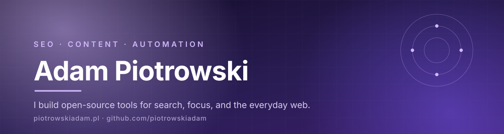

  

**SEO specialist at Rossmann. Content and automation nerd. I build open-source tools for people who work with search.**

[Blog](https://piotrowskiadam.pl) · [LinkedIn](https://www.linkedin.com/in/adam-piotrowski/) · [Ko-fi](https://ko-fi.com/B5Z022ZL32)

---

## Hi, I'm Adam

I have spent the last six years in SEO, currently at **Rossmann**, where I work at the intersection of search, content, and automation. My day-to-day is technical SEO, content strategy, and building workflows with **Make.com, n8n, and APIs** so the repetitive parts take care of themselves.

Away from the spreadsheet, I build the tools I miss: native apps, browser extensions, and small utilities that make SEO and everyday workflows faster, calmer, and more local-first. Most of them are open source, and all of them are things I actually use.

## What I'm building

| Project | What it does | Stack |
| --- | --- | --- |
| **[Tadpole](https://github.com/piotrowskiadam/Tadpole)** | Native desktop SEO crawler and site auditor: local crawls, schema checks, internal-link diagnostics, and clean Markdown exports. | Rust · GTK4 · Libadwaita |
| **[Souffleur](https://github.com/piotrowskiadam/souffleur)** | Keyboard-first prompt library for Chrome and Firefox. Save prompts, open a Spotlight-style overlay, and copy without leaving the conversation. | JavaScript · WebExtensions |
| **[Purple Haze](https://github.com/piotrowskiadam/Purple-Haze-Ghost-Theme)** | Dark Ghost theme for long reads, with a sticky table of contents and purple accents. It powers this blog. | Ghost · CSS · JavaScript |
| **[Charlie · repertuar](https://github.com/piotrowskiadam/kino-charlie-android)** | Unofficial, offline-first Android app for the Kino Charlie repertoire in Łódź. Pick a film, check the screening room, then head to the box office. | Kotlin · Jetpack Compose · Material 3 |
| **[Spring Countdown](https://github.com/piotrowskiadam/spring-countdown)** | GNOME Shell desktop widget and top-bar indicator counting down the weeks, days, or Mondays until spring. | JavaScript · GJS · GNOME Shell |

## Toolbox

Technical SEO · content strategy · marketing automation · AI-assisted workflows

## Writing

I write about search, AI, and the craft of building useful things.

- [Google AI Mode kontra Perplexity: ocena wyników](https://piotrowskiadam.pl/google-ai-mode-kontra-perplexity-ocena-wynikow/)
- [All posts on piotrowskiadam.pl](https://piotrowskiadam.pl)

## GitHub, lately

  
  

---

**Open to conversations about SEO, AI, automation, and open source.** The fastest way to reach me is [LinkedIn](https://www.linkedin.com/in/adam-piotrowski/).

If something here saved you time, you can [buy me a coffee](https://ko-fi.com/B5Z022ZL32).

